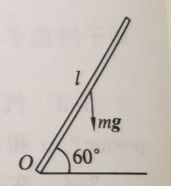
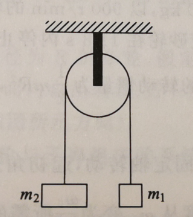
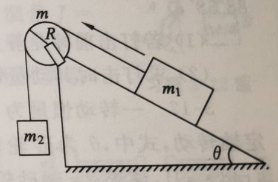
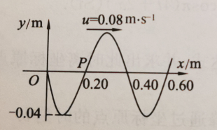
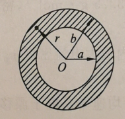
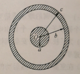

# Selected Problems (University Physics)

## Chapter 1 Kinematics of a Particle

### 1-4
A particle moves along the $x$ axis with acceleration $a = 4 + 3t$, where $t$ is in $\mathrm{s}$ and $a$ in $\mathrm{m \cdot s^{-2}}$. At $t=0$, $x = 2 \ \mathrm{m}$ and $v = 5 \ \mathrm{m \cdot s^{-1}}$. Find the velocity and position of the particle at $t=10 \mathrm{s}$.

---

### 1-6
A particle moves in a straight line; its instantaneous acceleration varies as $a = -A\omega^2 \cos\omega t$. At $t=0$, $v_x = 0$ and $x = A$, where $A$ and $\omega$ are positive constants. Find the kinematic equation of the particle.

---

## Chapter 2 Dynamics of a Particle

### 2-7
A particle of mass $1 \ \mathrm{kg}$ moves in a straight line under a force $F = 3 + 4t$ ($\mathrm{SI}$), starting from $v_0 = 10 \ \mathrm{m \cdot s^{-1}}$ (the direction of $v_0$ is the same as that of the force). Find:

(1) the impulse $I$ of the force during $0 \sim 2 \ \mathrm{s}$;

(2) the velocity of the particle at $t=2 \ \mathrm{s}$.

---

### 2-10
While a bullet travels down a gun barrel, the net force on it has magnitude $F = 400 - \frac{4}{3} \times 10^5 t$, and its speed when it leaves the muzzle is $300 \ \mathrm{m \cdot s^{-1}}$. The net force happens to be zero exactly where the bullet leaves the barrel. Find:

(1) the time $t$ the bullet takes to travel the full length of the barrel;

(2) the impulse $I$ of the force on the bullet while it is in the barrel;

(3) the mass $m$ of the bullet.

---

### 2-16
An object of mass $2 \ \mathrm{kg}$ moves in the positive $x$ direction under a variable force $F_x = 4 + 6x$ ($\mathrm{SI}$). At $t=0$, $x_0 = 0$ and $v_0 = 0$. Find:

(1) the work done by the variable force as the object moves from $x=0$ to $x=4 \mathrm{m}$;

(2) the speed of the object at $x=4 \mathrm{m}$;

(3) the impulse of the variable force during the motion from $x=0$ to $x=4 \mathrm{m}$.

---

### 2-18
A particle of mass $m = 0.5 \ \mathrm{kg}$ moves in a plane with kinematic equations $x = 5t$, $y = 0.5t^2$ ($\mathrm{SI}$). Find the work done by the external force on the particle from $t=2 \mathrm{s}$ to $t=4 \mathrm{s}$.

---

## Chapter 3 Rotation of a Rigid Body about a Fixed Axis

### 3-6
A uniform straight rod of length $1 \mathrm{m}$ can rotate about a smooth, horizontal, fixed axis through one end and perpendicular to the rod. The other end is raised so that the rod makes a $60^\circ$ angle with the horizontal, and the rod is then released from rest, as shown in the figure. The moment of inertia of the rod about the axis is $\frac{1}{3}ml^2$, where $m$ and $l$ are the mass and length of the rod. Find:

*Figure for Exercise 3-6*

---

### 3-8
An Atwood machine is used to measure the moment of inertia of a pulley. As shown in the figure, the two ends of the string over the pulley carry weights of mass $m_1 = 0.46 \ \mathrm{kg}$ and $m_2 = 0.50 \ \mathrm{kg}$ respectively; the pulley has radius $0.05 \mathrm{m}$, and friction at the axle and the mass of the string are negligible. Starting from rest, the weights are released, and in $5.0 \mathrm{s}$ a weight is measured to descend $0.75 \mathrm{m}$. What is the moment of inertia of the pulley?

*Figure for Exercise 3-8*

---

### 3-10
As shown in the figure, a block of mass $m_1 = 5 \ \mathrm{kg}$ slides down an incline of angle $\theta = 30^\circ$ with coefficient of kinetic friction $\mu = 0.25$. The block is tied to a string that passes over a fixed pulley and carries a weight of mass $m_2 = 10 \ \mathrm{kg}$ at its other end. The string does not slip on the pulley; the pulley, a uniform disk of mass $m = 20 \ \mathrm{kg}$ and radius $R = 20 \ \mathrm{cm}$. Find the acceleration $a$ of the weight and the tension $T$ of the string.

*Figure for Exercise 3-10*

---

## Chapter 6 Mechanical Oscillations and Mechanical Waves

### 6-5
A particle undergoes simple harmonic motion with period $2 \mathrm{s}$ and amplitude $0.06 \mathrm{m}$; at $t=0$ the particle is exactly at the negative-direction maximum displacement. Find:

(1) the kinematic equation of the particle;

(2) the wave expression of the one-dimensional simple harmonic wave formed when this oscillation propagates in the positive $x$ direction at wave speed $u = 2 \ \mathrm{m \cdot s^{-1}}$ (take the equilibrium position of the particle as the origin);

(3) the wavelength of the wave.

---

### 6-10
The figure shows the waveform of a plane simple harmonic wave at $t=0$. Find:

(1) the wave expression of the wave;

(2) the equation of motion of the particle at $P$ ($x = 0.20 \ \mathrm{m}$).

*Figure for Exercise 6-10*

---

## Chapter 9 Electrostatic Field

### 9-9
Positive charge of volume density $\rho = 10^{-9} \ \mathrm{C \cdot m^{-3}}$ is uniformly distributed between two hypothetical concentric spherical surfaces of radii $10 \mathrm{cm}$ and $20 \mathrm{cm}$. Find the electric field strength at $5 \mathrm{cm}$, $15 \mathrm{cm}$ and $50 \mathrm{cm}$ from the center.

---

### 9-12
An "infinitely long" straight circular cylinder of radius $R$ is uniformly charged with volume charge density $\rho$. Find the distribution of its electric field strength and sketch the $E$-$r$ curve.

---

### 9-22
Two concentric spherical surfaces have radii $10 \mathrm{cm}$ and $30 \mathrm{cm}$. The smaller surface carries positive charge $10^{-8} \ \mathrm{C}$ uniformly distributed, and the larger one positive charge $1.5 \times 10^{-8} \ \mathrm{C}$. Find the electric potential at $20 \mathrm{cm}$ and $50 \mathrm{cm}$ from the center.

---

## Chapter 10 Steady Magnetic Field

### 10-9
A hollow cylindrical conductor has inner and outer radii $a$ and $b$ and carries a current $I$. The current $I$ is uniformly distributed over the cross-section of the conductor. Prove that the magnitude of the magnetic induction $B$ at every point inside the conductor ($a < r < b$) is given by

$$B = \frac{\mu_0 I}{2\pi(b^2 - a^2)} \frac{r^2 - a^2}{r}$$

Check this formula in the limiting case $a = 0$. What is it for $r \geq b$?

*Figure for Exercise 10-9*

---

### 10-10
A very long coaxial cable consists of a solid cylindrical conductor (radius $a$) and a coaxial cylindrical shell (inner and outer radii $b, c$), as shown. In use, a current $I$ flows out through one conductor and returns through the other, both uniformly distributed over their cross-sections. Find the magnitude of the magnetic induction in each region:

(1) inside the inner conductor ($r < a$)

(2) between the two conductors ($a < r < b$)

(3) within the shell ($b < r < c$)

(4) outside the cable ($r > c$)

*Figure for Exercise 10-10*

