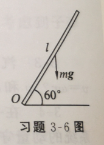
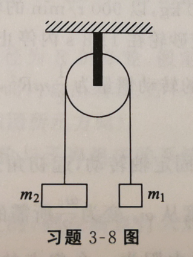
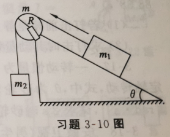
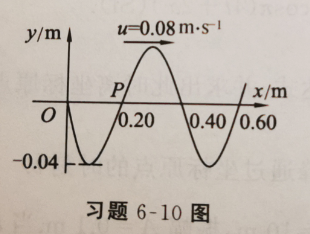
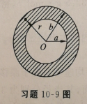
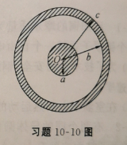

# 物理大题整理

## 第1章 质点运动学

### 1-4
一质点沿 $x$ 轴运动，其加速度为 $a = 4 + 3t$，式中，$t$ 以 $\mathrm{s}$ 计，$a$ 以 $\mathrm{m \cdot s^{-2}}$ 计。在 $t=0$ 时，$x = 2 \ \mathrm{m}$，$v = 5 \ \mathrm{m \cdot s^{-1}}$，求该质点在 $t=10 \mathrm{s}$ 时的速度和位置。

---

### 1-6
一质点做直线运动，其瞬时加速度的变化规律为 $a = -A\omega^2 \cos\omega t$，在 $t=0$ 时，$v_x = 0$，$x = A$，其中 $A$、$\omega$ 均为正常量，求此质点的运动学方程。

---

## 第2章 质点动力学

### 2-7
一质量为 $1 \ \mathrm{kg}$ 的质点在力 $F = 3 + 4t$（$\mathrm{SI}$）的作用下，从 $v_0 = 10 \ \mathrm{m \cdot s^{-1}}$ 开始做直线运动（$v_0$ 的方向与力的方向相同），求：

（1）$0 \sim 2 \ \mathrm{s}$ 内力的冲量 $I$；

（2）$t=2 \ \mathrm{s}$ 时质点的速度。

---

### 2-10
一颗子弹在枪筒里前进时所受的合力大小为 $F = 400 - \frac{4}{3} \times 10^5 t$，子弹从枪口射出时的速率为 $300 \ \mathrm{m \cdot s^{-1}}$。设子弹离开枪口处合力刚好为零。求：

（1）子弹走完枪筒全长所用的时间 $t$；

（2）子弹在枪筒中所受力的冲量 $I$；

（3）子弹的质量 $m$。

---

### 2-16
一质量为 $2 \ \mathrm{kg}$ 的物体，在一变力 $F_x = 4 + 6x$（$\mathrm{SI}$）作用下，沿 $x$ 轴正方向运动。已知在 $t=0$ 时，$x_0 = 0$，$v_0 = 0$，求：

（1）物体在由 $x=0$ 运动到 $x=4 \mathrm{m}$ 的过程中变力对物体所做的功；

（2）在 $x=4 \mathrm{m}$ 处物体的速度；

（3）物体在由 $x=0$ 运动到 $x=4 \mathrm{m}$ 的过程中变力的冲量。

---

### 2-18
质量 $m = 0.5 \ \mathrm{kg}$ 的质点，在一平面内运动，其运动学方程为 $x = 5t$，$y = 0.5t^2$（$\mathrm{SI}$），求从 $t=2 \mathrm{s}$ 到 $t=4 \mathrm{s}$ 这段时间内外力对质点所做的功。

---

## 第3章 刚体的定轴转动

### 3-6
一长为 $1 \mathrm{m}$ 的均匀直棒可绕过其一端且与棒垂直的水平光滑固定轴转动。抬起另一端使棒向上与水平面成 $60^\circ$，然后无初转速地将棒释放，如图所示。已知棒对轴的转动惯量为 $\frac{1}{3}ml^2$，其中 $m$ 和 $l$ 分别为棒的质量和长度。求：

---

### 3-8
用阿特伍德机测量滑轮的转动惯量。如图所示，滑轮两端分别悬挂质量各为 $m_1 = 0.46 \ \mathrm{kg}$、$m_2 = 0.50 \ \mathrm{kg}$ 的重物，滑轮半径为 $0.05 \mathrm{m}$，滑轮与轴承间的摩擦力及绳的质量可略去不计。实验时，自静止开始，释放重物后并测得 $5.0 \mathrm{s}$ 内重物下降了 $0.75 \mathrm{m}$，则滑轮的转动惯量是多少？

---

### 3-10
如图所示，质量 $m_1 = 5 \ \mathrm{kg}$ 的木块在倾角 $\theta = 30^\circ$ 的斜面上滑动，动摩擦因数 $\mu = 0.25$，木块由绕过定滑轮的细绳拴着，绳的另一端挂着质量 $m_2 = 10 \ \mathrm{kg}$ 的重物。设绳与滑轮之间无滑动，并已知可视为均匀圆盘的滑轮的质量 $m = 20 \ \mathrm{kg}$，半径 $R = 20 \ \mathrm{cm}$，求重物的加速度 $a$ 及绳子的张力 $T$。

---

## 第6章 机械振动与机械波

### 6-5
某质点做简谐运动，周期为 $2 \mathrm{s}$，振幅为 $0.06 \mathrm{m}$，$t=0$ 时刻，质点恰好处在负方向最大位移处，求：

（1）该质点的运动学方程；

（2）此振动以波速 $u = 2 \ \mathrm{m \cdot s^{-1}}$ 沿 $x$ 轴正方向传播时形成的一维简谐波的波动表达式（以该质点的平衡位置为坐标原点）；

（3）该波的波长。

---

### 6-10
图示为一列平面简谐波在 $t=0$ 时刻的波形图。求：

（1）该波的波动表达式；

（2）$P$ 处（$x = 0.20 \ \mathrm{m}$）质点的运动方程。

---

## 第9章 静电场

### 9-9
在半径分别为 $10 \mathrm{cm}$ 和 $20 \mathrm{cm}$ 的两层假想同心球面中间，均匀分布着电荷体密度 $\rho = 10^{-9} \ \mathrm{C \cdot m^{-3}}$ 的正电荷。求离球心 $5 \mathrm{cm}$、$15 \mathrm{cm}$、$50 \mathrm{cm}$ 处的电场强度。

---

### 9-12
半径为 $R$ 的"无限长"直圆柱体内均匀带电，电荷体密度为 $\rho$，求其电场强度分布，并作 $E$-$r$ 曲线。

---

### 9-22
两个同心球面，半径分别为 $10 \mathrm{cm}$ 和 $30 \mathrm{cm}$。小球面均匀带有正电荷 $10^{-8} \ \mathrm{C}$，大球面带有正电荷 $1.5 \times 10^{-8} \ \mathrm{C}$。求离球心分别为 $20 \mathrm{cm}$、$50 \mathrm{cm}$ 处的电势。

---

## 第10章 恒定磁场

### 10-9
如图所示的空心柱形导体，柱的半径分别为 $a$ 和 $b$，导体内载有电流 $I$。设电流 $I$ 均匀分布在导体横截面上。证明：导体内部各点（$a < r < b$）的磁感应强度 $B$ 的大小由下式给出：

$$B = \frac{\mu_0 I}{2\pi(b^2 - a^2)} \frac{r^2 - a^2}{r}$$

试以 $a = 0$ 的极限情形来检验这个公式。试问 $r \geq b$ 时又如何？

---

### 10-10
一根很长的同轴电缆，由一导体圆柱（半径为 $a$）和一同轴的导体圆管（内外半径分别为 $b, c$）构成，如图所示。使用时，电流 $I$ 从一导体流去，从另一导体流回。设电流都是均匀地分布在导体的横截面上的。求以下各区域的磁感应强度的大小：

（1）导体圆柱内（$r < a$）

（2）两导体之间（$a < r < b$）

（3）导体圆筒内（$b < r < c$）

（4）电缆外（$r > c$）

